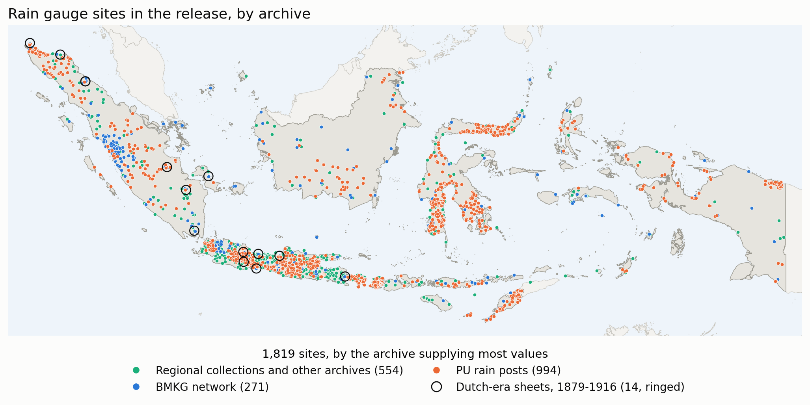
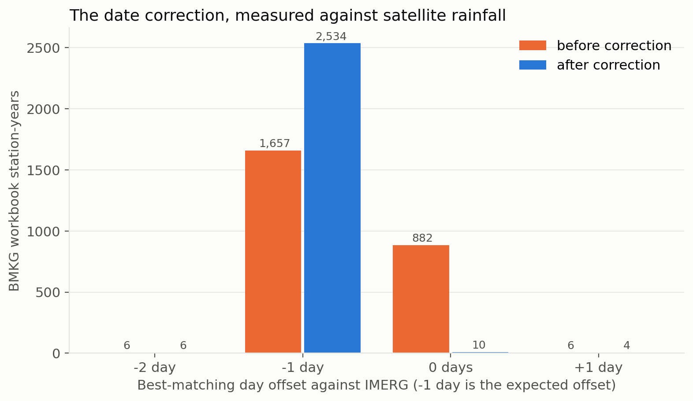
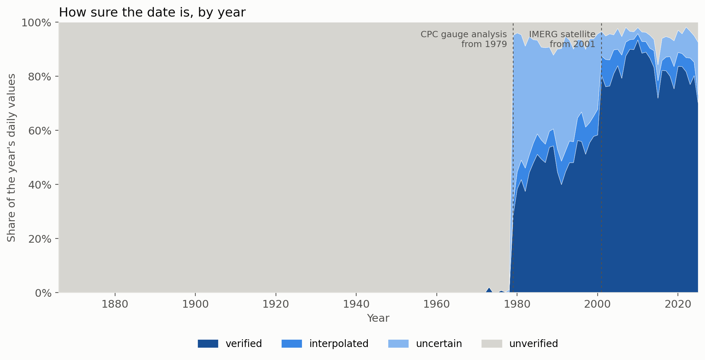
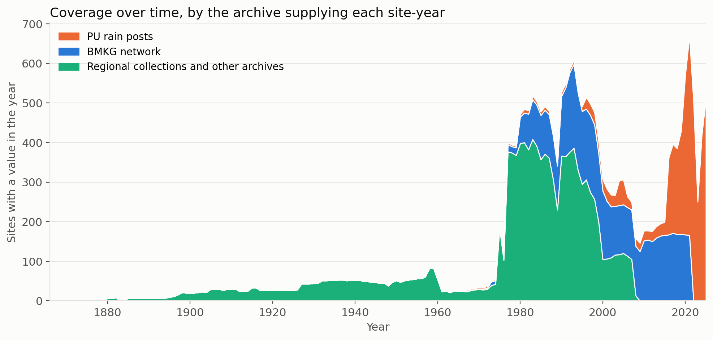
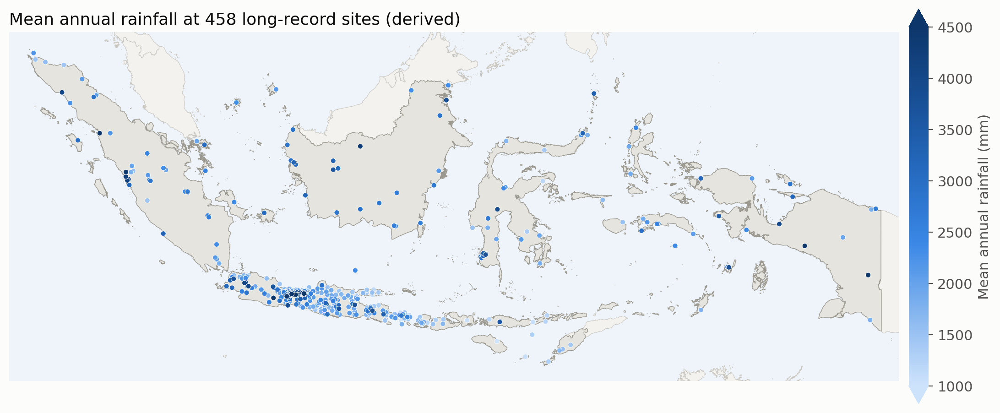

I wanted one thing that should be simple: a long daily rainfall series for as many Indonesian stations as I could get, in one file, with a note on where each value came from. What I have now is that file: 6.8 million site-days at 1,819 sites, from 1866 to 2025. Getting to it took far longer than the gridding work it was meant to feed, and the reason is worth writing down, because it is the kind of problem that does not appear in any method section and quietly corrupts results if you skip it.

A first version of this post, in October, described ten archives and 1950 to 2021. Since then the record has grown in both directions: back to the Dutch-era sheets of the 1870s, and forward to 2025 through the Ministry of Public Works' rain posts. A draft release now sits in the project's public repository, [wxgrid](https://github.com/bennyistanto/wxgrid), and is described on its [CSR page](../csr/idn-station-rainfall.qmd). The observations keep the terms of the archives they come from; for two of them I am still confirming those terms. The numbers below are measured from that release, by scripts named in the project notes, and I describe patterns rather than reprinting any station's series.

## The starting problem

Indonesia has a dense rain gauge network by regional standards, and almost none of its daily record is easy to get now. BMKG's public data portal, Data Online, today offers climate data only as monthly values, for at most two stations per request, and only for the last two years; its own FAQ ties this to Peraturan BMKG No. 4 Tahun 2022 on data access ([dataonline.bmkg.go.id](https://dataonline.bmkg.go.id/)). Daily values for the long record are not on the public tap any more.

The obvious fallback is the international archives, and for rainfall they disappoint. GHCN-Daily, NOAA's global daily database, has 104 Indonesian stations, but its rainfall is nearly empty after about 2005: a few hundred station-days a year across the whole country. The reason is mechanical, and I find it clarifying. Take Soekarno-Hatta International Airport in Jakarta in 2015. The Global Summary of the Day, which is what reaches GHCN for these stations, has 342 daily precipitation entries that year; by its own attribute flags, 227 of them are "no precipitation reported", most of the rest are partial six-hour sums, and exactly three are complete days built from all four six-hour reports (flag meanings: the [GSOD documentation](https://www.ncei.noaa.gov/data/global-summary-of-the-day/doc/readme.txt)). GHCN keeps the three. The daily rainfall never fully entered the global exchange, so no amount of downloading recovers it.

There is one open door, and it is not BMKG's. The Ministry of Public Works (PU) runs its own network of rain posts for river-basin management and publishes the daily data on its water resources portal ([pdsda.sda.pu.go.id](https://pdsda.sda.pu.go.id/)): 989 posts with rainfall, most of the data from 2016 onward. Everything else lives in scattered files: spreadsheets emailed years ago, a regional archive, an old database on a disk, a set of Dutch-era daily sheets. I ended up pulling values from fourteen of them. The largest are two releases of the Southeast Asian Climate Assessment and Dataset (SACA&D, [sacad.bmkg.go.id](https://sacad.bmkg.go.id/); use is free with acknowledgement of [van den Besselaar et al. 2015](https://doi.org/10.1175/BAMS-D-13-00249.1)), BMKG's own station workbooks, a daily Indonesian database from the ASEAN compendium family, and the PU posts. Different formats, different codes, different conventions. The work was turning them into one table where every value still knows its origin.

| Source | What it is | Years | Sites | Site-days supplied |
|---|---|---|---|---|
| SACA&D (2022 release) | Regional archive, BMKG and partners | 1866-2008 | 158 | 1,712,726 |
| BMKG station workbooks | The 180-station met network | 1980-2021 | 179 | 1,590,535 |
| ASEAN compendium (daily) | Digitised national database | 1975-2000 | 401 | 1,432,431 |
| PU rain posts (SIHKA) | Ministry of Public Works, published online | 1975-2025 | 967 | 1,255,813 |
| SACA&D (2013 release) | Earlier archive, stations since dropped | 1926-2008 | 44 | 251,140 |
| West Sumatra rain posts | BMG compilation | 1991-2001 | 53 | 118,464 |
| East Java Dinas PU posts | Field-collected rain posts | 1950-2006 | 44 | 115,967 |
| BMKG agro-climate stations | Agricultural research stations | 1973-1995 | 33 | 106,079 |
| BMKG national daily sheets | Nationwide daily compilation | 1990-2002 | 72 | 76,904 |
| Dutch-era daily sheets | Colonial meteorological service | 1879-1916 | 14 | 73,662 |
| BMKG rain post forms | Regional office forms, NTT, NTB, Bali | 1967-2005 | 6 | 59,093 |
| South Sumatra district posts | Agriculture office compilations | 2000-2007 | 11 | 12,033 |
| F-KLIM Sumatera | Multi-variable daily forms | 1991-2001 | 7 | 5,452 |
| Larantuka climate station | Single station, NTT | 1985-1996 | 1 | 4,179 |

: Fourteen archives. "Site-days supplied" counts the days each one contributes to the released rainfall product, after higher-priority sources had their say; "Sites" counts the sites where it supplies at least one day. Two more archives, GHCN-Daily and SACA&D's series derived from weather reports, are read for cross-checks and supply no value. {tbl-colwidths="[24,30,12,10,24]"}

Laid on a map, the compiled sites show what a century and a half of fragmented record-keeping leaves behind: dense in Java, thinner the further east you go, and the PU posts now the largest group, 994 of the 1,819 sites, spread through Sulawesi, Kalimantan and Nusa Tenggara.

{fig-alt="Map of Indonesia with rain gauge sites as dots in three colours, dense over Java and sparser eastward, with fourteen ringed Dutch-era sites in Sumatra and Java"}

## The date was the hard part

I expected the hard part to be matching stations or cleaning outliers. It was neither. It was the date.

A BMKG daily rainfall value is the total over the 24 hours observed at 07:00 local time (BMKG's FAQ defines the rainfall element, RR, exactly that way). There is a convention for which calendar day that total is labelled with. The trouble is that the label is not applied consistently: in the station workbooks it drifts, station by station and period by period.

I only caught this because the same gauge often appears in more than one archive, and the copies disagreed about which day a given fall of rain landed on, by exactly one day, in some years and not others. To find out which copy was right I compared every rainfall series against two independent references that are dated consistently: IMERG satellite rainfall, and the CPC global gauge analysis. The test is blunt. Shift a station's series by -2, -1, 0 and +1 day against the reference grid cell over its own location, and see which shift correlates best, year by year.

The result was clear and a little alarming. Against these references, the SACA&D copies were stable, and the BMKG workbooks were not: before correction, 1,657 of 2,551 station-years sat at the expected one-day offset, and nearly all the rest were a day off. Worse, a single station would be correct for a decade and then jump, with no single switch year across the network. The correction has to be made per series and per period, not once. After applying it, 2,534 of 2,554 station-years sit at the expected offset, and the two independent references, IMERG and CPC, agreed on the offset in 95 per cent of the periods where both could judge.

{fig-alt="Grouped bar chart of BMKG station-years by best day offset, before and after correction, with the after bars concentrated at minus one day"}

The other archives brought their own versions of the problem. The PU portal stamps each day at midnight UTC, and against CPC most PU posts land one day earlier than the BMKG convention (the best offset was 0 for 468 manual posts and -1 for 173), so they go through the same per-series correction. One agro-climate gauge near Mojokerto looked merely noisy until it was compared with its five nearest neighbours: its dates move between three different offsets across seven periods from the 1970s to the 1990s, and its correlation with the neighbour mean rises from 0.32 to 0.49 once each period is set right (an optimistic figure, since the periods were fitted against that same mean). Nothing in the file says so; only the rain gives it away.

I want to be plain about what this means and does not mean. It does not mean the rainfall values are wrong; the millimetres are fine. It means a day's rain was sometimes filed under the wrong date, and anyone who compares these gauges against satellite rainfall, or sums them into events, without checking the label will get a smeared, slightly wrong answer and never see why. In the release each value carries both its original date and a label saying how confident the correction is. From 1979 onward, 63 per cent of values are verified and another 7 per cent interpolated between verified periods; 24 per cent are only "uncertain", mostly in the 1980s and 1990s, when only the coarse half-degree gauge analysis is available as a reference and the dense village rain posts are too fine for it to judge. Before 1979 there is no gridded reference at all, so nothing is verified, and I would rather mark that than hide it.

{fig-alt="Stacked area chart of the share of daily rainfall values by date-confidence class per year, 1866 to 2025, grey until 1979 and mostly dark blue after 2001"}

## Names lie; the data tells the truth

The second surprise was identity. To merge archives you must know when two files describe the same place, and station names are a poor guide.

The clearest case: a BMKG workbook labelled "Kemayoran", the old Jakarta station, carries, on inspection, the data of the Jakarta Observatorium series from another archive, matching it on 91 per cent of their six thousand shared days, while matching the archive's actual "Kemayoran" series only weakly and a day out of step. The name on the file was not the source of the numbers. I found several like this. The rule I settled on is that data identity beats the label: two series are the same station only when their values agree where they overlap, or when they share a WMO station number, which they sometimes keep even after the recorded coordinates have gone stale by tens of kilometres. Every such decision is written down in a crosswalk I reviewed by hand.

Data identity also works in the other direction. The Dutch-era sheets hold a Batavia record from the 1880s to 1911, and it turns out to be the same gauge SACA&D already carries for Jakarta, one day out of step, recorded in whole millimetres where SACA&D has tenths; I kept SACA&D's copy and did not read it twice. The rest of the Dutch-era record is not in SACA&D at all: of the 33,697 rain days on the sheets, 31,985 have no match there. They sit within a few kilometres of modern stations in towns like Medan, Semarang and Cilacap, but their records end in 1916 and the modern ones begin in 1958 or later, so nothing in the data can show that they are the same gauge. They stay as their own sites.

Two rules are about owners, not about data. PU posts are never merged with BMKG stations, even when they stand side by side, because each ministry runs its own network and its own sites. And SACA&D's gap-filled series are built partly from neighbouring stations, and the file that lists a station's sources includes those neighbours. Read naively, that copies one gauge's rain onto several nearby stations, which is precisely the false agreement that would flatter any later validation. Pulling those apart, so each location keeps only its own observations, removed every such duplicated value from the merged rainfall.

## Places move, on paper

The third surprise was position, and it mostly came with the newer sources.

Some of it is plain reading error, and mine. The East Java PU sheets usually write coordinates as degrees and minutes, so my reader took every number that way. Two Madura posts write decimal degrees instead, which read as minutes put them at latitude -33 and longitude 209, outside the map; 16,037 daily values fell silently out of the build until the gap was noticed.

Some of it is the source. On the PU portal, one Papua post sat in Sumatra: its longitude was written 104.08747 where 140.08747 belongs, a single transposed digit and four thousand kilometres. Its nearest partner gauge was 4,000 km away; moved to Papua, its correlation with CPC rose from 0.08 to 0.42. Another post sat 77 km out at sea. Others shared a position with a different post, copied from a neighbouring entry.

Ten-odd cases can be fixed by hand; a thousand posts need a reference. PU also keeps a register of its posts on the same portal, with positions entered separately, so I compared the two. Matched by name, 793 of the 978 PU posts in the build agree within a kilometre. The 172 pairs further apart split into kinds: 17 positions copied from another post, 14 where one coordinate matches and the other differs by a single digit, 5 at sea, and a long tail where neither position is clearly better. I took the register's position for all of them except nine: one pair that shares a name but belongs to different offices, and eight posts where the neighbouring rainfall favoured the published position, which keep it, flagged as approximate. 169 posts moved, a median of 5 km.

{fig-alt="Horizontal bar chart of PU rain posts by distance between portal and register positions: 649 under 0.1 km, 95 at 0.1 to 1 km, 80 at 1 to 5 km, 64 at 5 to 25 km, 28 over 25 km"}

## Zeros that were not zeros, and codes that were not missing

Then the ordinary quality problems. They are worth repeating because each would bias rainfall upward or downward in a way that looks plausible.

Some zeros are not dry weather. One station on Ambon reads 0 mm on every single day for roughly thirty years, through a period when the satellite and every neighbour show the usual wet-season rain: a gauge that stopped reporting, filled with zeros. The East Java sheets hold 107 year-sheets that are 0.0 in every cell, at six posts whose other years total a median 1,100 to 1,900 mm: blank templates, not drought, and some of them were hiding the filled copy of the same year. On the PU portal, 882 whole months of zeros sit where CPC or the posts around them show 100 mm or more; they are read as missing, not dry.

The opposite error hides in codes. BMKG workbooks use the value 8888 on about 116,000 of the released days. I had first assumed, as one does, that it meant missing. The workbook legend says otherwise: 8888 is "data tidak terukur", measured but too small to register, and 9999 is the true no-data code. The national daily sheets write the same thing as "TU" or "TTU", short for *tidak terukur*. Treating these as missing would throw away a hundred thousand genuine near-zero rain days and subtly wet the record. They are now kept as observed, flagged as unmeasurable. That correction, incidentally, reaches back into an earlier project of mine that had counted 8888 as missing; I have noted it there too.

The rain post forms are the trap I like least, because the same two symbols mean opposite things in different provinces. In the BMKG regional forms from NTT, NTB and Bali, "-" is a dry day and "0" is rain too small to measure: the forms' own monthly rain-day counts include the zeros and exclude the dashes in 99 per cent of months or more, and the printed legend says so. In the East Java PU forms, "-" means no data and "0" means no rain. Read with one rule, one of the two sets is misread. And the Dutch-era sheets mostly write nothing at all on a dry day: on blank days in months with any reading, SACA&D's copy of the Batavia gauge has 0 mm on 84 per cent of them, against 7 per cent on the sheets' rain days. Blank means dry in a reported month; a month that is blank throughout means the sheet was never filled.

## What came out

The result is a single daily rainfall product for Indonesia, 1866 to 2025: 6,814,478 site-days at 1,819 sites, from fourteen archives. Each value carries its source, its original and corrected date, the confidence of that correction, and quality flags, so a later user can be as strict as they need. Nothing is interpolated and nothing is homogenised; every value is an observation at a site.

The record is long but uneven. One site reports in 1870, 20 in 1900 and 52 in 1940; before 1950 there are 664,796 site-days at 73 sites, all from SACA&D and the Dutch-era sheets. The BMKG and compendium networks carry the record from the 1970s, peaking at 607 sites in 1993, and it thins to 177 by 2010 as several archives end. The PU posts bring it back: 669 sites report in 2021. The BMKG workbooks stop in 2021, so the years after that are PU's alone, and 2023 is thin because the portal holds little for that year.

{fig-alt="Stacked area chart of sites per year 1866 to 2025 in three archive families: green regional collections from the 1880s to 2008, blue BMKG network from 1980 to 2021, orange PU rain posts rising after 2016"}

What all this reconstruction is finally for is a map of the rain itself. Here is the long-term mean annual total at the 458 sites with ten or more nearly complete years. The median site gets about 2,150 mm a year; the driest twentieth of sites get under 1,350 mm and the wettest twentieth over 4,000 mm. On the map the lightest dots gather in Nusa Tenggara, the darkest in western Sumatra and the highlands of Java.

{fig-alt="Map of Indonesia with sites coloured by mean annual rainfall in shades of blue, darker in western Sumatra and the Java highlands, lighter in Nusa Tenggara"}

A few honest limits. BMKG's own daily record in this release ends in 2021; the open route forward is the WMO's WIS2 exchange, where BMKG has published daily climate values since May 2025, and the rest needs a formal request. PU's register lists about 1,800 rain posts, but the portal publishes data for 989; whole river-basin offices have none online. Some positions are known only roughly and are flagged as approximate. And for two archives, the ASEAN compendium database and the Dutch-era sheets, I am still tracing the published edition behind the copy I hold.

What I take from the whole exercise is a small, unglamorous lesson. The scarce resource in historical climate data is not the measurements, which often survive in some spreadsheet somewhere. It is the metadata: which day, which place, which code. Most of my time went into reconstructing that, and the parts I could not reconstruct I marked rather than guessed. Next come the other weather variables, starting with the temperature records already sitting in the same archives, and after them the gridded rainfall maps this was all built for.
