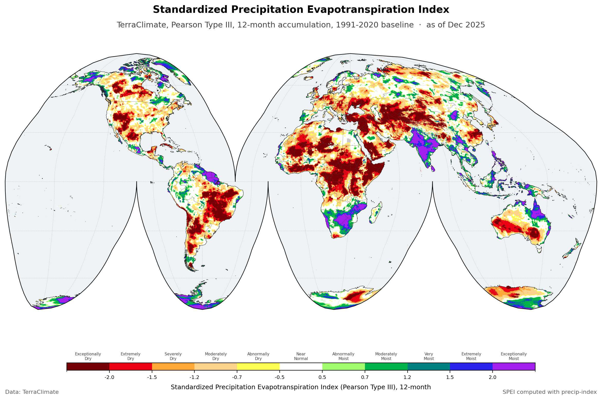
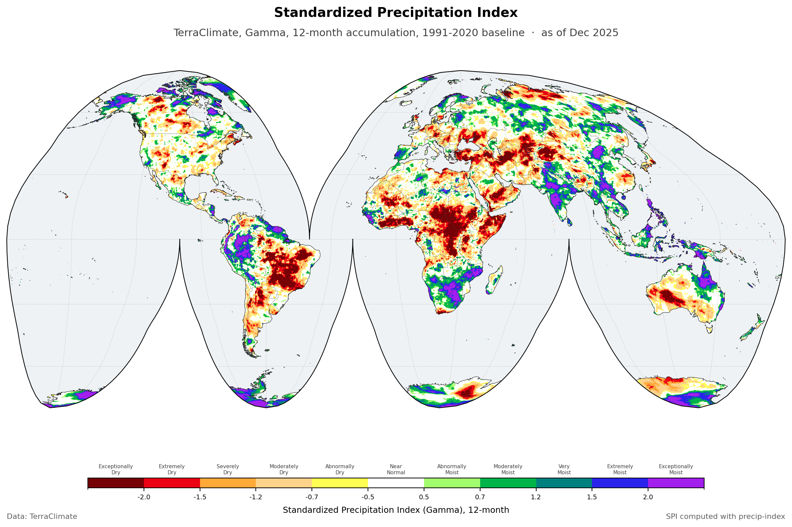
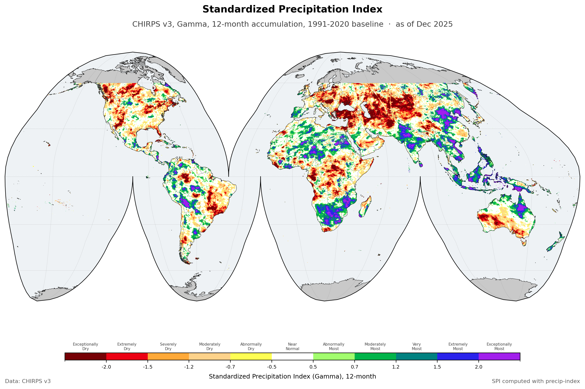
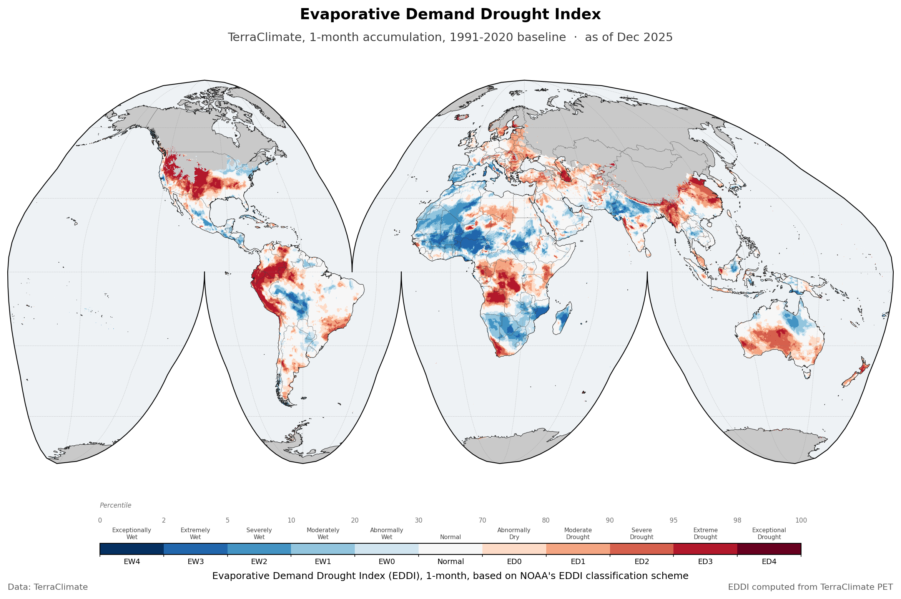

## Overview

Not the corporate kind. This is **Climate Social Responsibility**: a weekend project that shares climate data and the work behind it, free, for anyone who can use them.

{fig-alt="CSR" width=100%}

Two kinds of products live here. Global grids derived from open satellite records: rainfall, temperature and its anomalies, dry and wet spells, standardized precipitation indices, and crop phenology. And for Indonesia, daily observations from rain gauges and climate stations, gathered from many archives into one consistent dataset.

Every country's meteorological service holds the authority for official climate data, and nothing here competes with that. These products are complementary: a consistent global view for the cases where that is the more practical starting point, and a second opinion where ground observations are thin. For the station data this matters even more: the observations belong to BMKG, the Ministry of Public Works and the other providers, and each keeps its own terms.

It runs at weekend pace. There is no release schedule and no deadline. Products go up when they are ready.

## About the data

Gridded data ships as netCDF or GeoTIFF on a geographic coordinate system, EPSG:4326 with the WGS84 datum. Station data ships as CSV and as netCDF (CF timeSeries), with coordinates in the same system.

`+proj=longlat +ellps=WGS84 +datum=WGS84 +no_defs`

Resolution, coverage, period and method differ from one product to the next, so each dataset has its own page carrying those details and its download links.

Everything derived here is released under [CC-BY-4.0](https://creativecommons.org/licenses/by/4.0/) unless its product page says otherwise: use it for anything you like, including commercially, as long as you credit this site and the original data source and say so if you changed it. The source datasets keep their own licences, which each product page names.

### Disclaimer

Everything here is provided as a public service, with no warranty as to accuracy, content or fitness for any purpose. Read the source and method notes on a dataset page before using it for anything that matters. If you find an error, tell me and it gets fixed in the next update.

## Available datasets

---

```{=html}
<div class="datasets-grid">

<a href="csr/terraclimate-spei.html" class="dataset-card">
  
  <div class="dataset-content">
    <div class="dataset-year">1950-2025</div>
    <h3 class="dataset-title">TerraClimate SPEI</h3>
  </div>
</a>

<a href="csr/terraclimate-spi.html" class="dataset-card">
  
  <div class="dataset-content">
    <div class="dataset-year">1950-2025</div>
    <h3 class="dataset-title">TerraClimate SPI</h3>
  </div>
</a>

<a href="csr/chirps-spi.html" class="dataset-card">
  
  <div class="dataset-content">
    <div class="dataset-year">1981-2025</div>
    <h3 class="dataset-title">CHIRPS SPI</h3>
  </div>
</a>

<a href="csr/terraclimate-eddi.html" class="dataset-card">
  
  <div class="dataset-content">
    <div class="dataset-year">1950-2025</div>
    <h3 class="dataset-title">TerraClimate EDDI</h3>
  </div>
</a>

<a href="csr/idn-station-rainfall.html" class="dataset-card">
  <div class="dataset-content">
    <div class="dataset-year">Daily, from 1950</div>
    <h3 class="dataset-title">Indonesia Station Rainfall</h3>
  </div>
</a>

</div>
```
