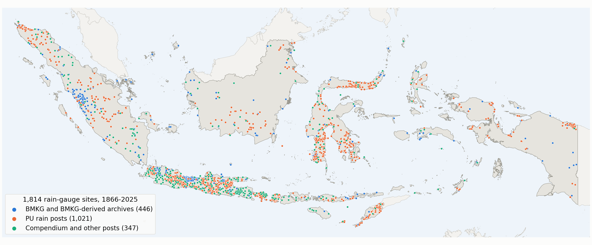
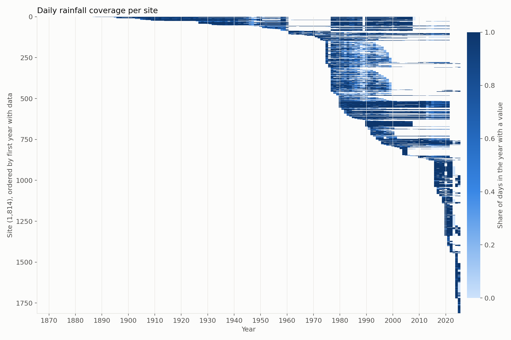
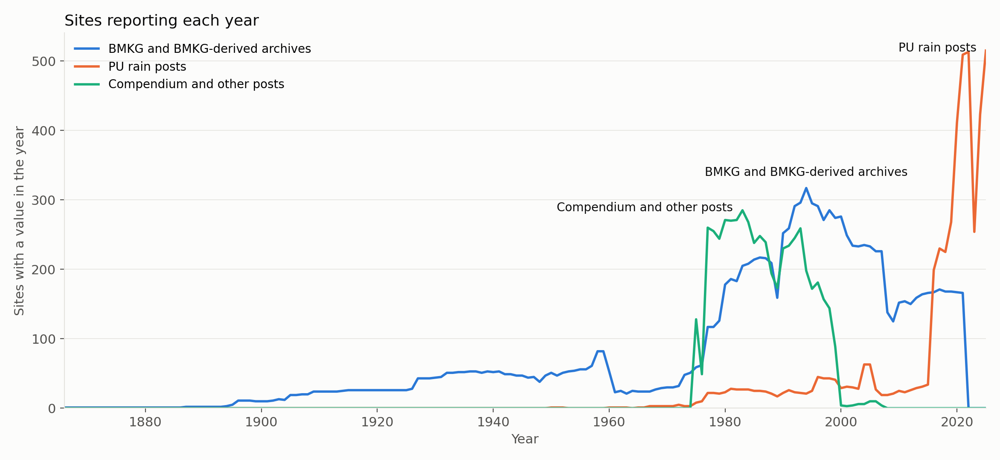

<!-- Confirm the period, site count and file sizes from summary.json of the release build before publishing. -->

Daily rainfall observed at rain gauges and climate stations across Indonesia, gathered from national workbooks, provincial rain-post forms, river-basin archives, and regional and global collections into one consistent dataset. Nothing is interpolated: every value is an observation at a site. It is not a gridded product (that is on the list), and it is not homogenised.

The observations themselves are official records: BMKG station data, much of it downloaded from [BMKG Data Online](https://dataonline.bmkg.go.id/), and the Ministry of Public Works' rain posts, which the Ministry publishes openly on its [water resources data portal](https://pdsda.sda.pu.go.id/). What is not official is the compilation: how the archives are combined, checked and flagged here is my own work, not a product of BMKG, the Ministry or any other provider, and it does not replace their data.

::: {.project-meta}
::: {.meta-item}
::: {.meta-label}
Source
:::
::: {.meta-value}
Several archives, see [Sources and terms](#sources-and-terms)
:::
:::

::: {.meta-item}
::: {.meta-label}
Spatial coverage
:::
::: {.meta-value}
Indonesia, station points
:::
:::

::: {.meta-item}
::: {.meta-label}
Temporal resolution
:::
::: {.meta-value}
Daily
:::
:::

::: {.meta-item}
::: {.meta-label}
Period
:::
::: {.meta-value}
1866 to 2025
:::
:::

::: {.meta-item}
::: {.meta-label}
Format
:::
::: {.meta-value}
CSV
:::
:::

::: {.meta-item}
::: {.meta-label}
Coordinates
:::
::: {.meta-value}
EPSG:4326
:::
:::
:::

## Why compile it

Indonesia's daily rainfall record is scattered. Each archive holds a piece, and each writes missing days, trace rain and dry days in its own way, labels the day differently, and sometimes carries a copy of another station's data. Putting them side by side without that care produces false dry days, shifted dates and the same gauge counted twice.

This dataset brings them together **as observed**:

- Values are never changed. Each source's codes are decoded by its own rules: 8888, TU and TTU, for example, mean rain fell but below 0.5 mm.
- Problems are flagged, not deleted.
- Dates are aligned per series to the BMKG convention: 24 hours ending 07:00 local, labelled with the end date.
- The same gauge appearing in several archives is linked into one site.
- Every decision is written down with the measurement behind it.

::: {.callout-tip collapse="true"}
## Why this is more than copying files

- A gauge in Mojokerto whose dates drift by one or two days over two decades, found by comparing it with its neighbours.
- Rain posts on Madura that were missing from the dataset for years because their coordinates were written in a different format.
- 107 year sheets filled with zeros that turned out to be blank templates, not dry years.
- "TU", short for *Tidak Terukur* ("not measurable"), which means rain too light to measure, not missing.
:::

## Method

Each value comes from one source series. Where several sources cover the same site and day, the highest-priority source supplies the value, and the others only fill days it does not have, after passing an overlap test against it.

Dates are checked against IMERG Final (2001 onward) and CPC Unified (1979 onward). Before 1979 there is no gridded reference, so dates are as delivered and marked `unverified`.

## Coverage

The record is long but uneven. One site reports in 1870, about 10 in 1900 and about 50 by 1950, almost all from the Dutch-era stations that SACA&D carries. The network peaks in the late 1980s and 1990s at close to 500 sites a year, thins after 2000 as several archives end, and grows again from 2016 with the Ministry of Public Works' rain posts.

## What is in the files

::: {.callout-note collapse="true"}
## Long table: one row per site and day

| Column | Meaning |
|---|---|
| `site_id` | Site: one or more source stations judged to be the same place |
| `date` | Day in the target convention (24 hours ending 07:00 local, labelled with the end date) |
| `rr_mm` | Daily rainfall in mm; empty on a day observed as unmeasurable |
| `flag` | Empty, or `;`-separated codes (see Flags) |
| `day_label` | How sure the date is: `verified`, `interpolated`, `uncertain`, `unverified` |
| `date_raw` | The date as written in the source, before day-label correction |
| `source_dataset` | The archive the value came from |
| `source_station` | Station name and key in that archive |
| `series_id` | The exact source series |

Example rows (SACA&D, Stasiun Klimatologi Malang, January 1970):

| site_id | date | rr_mm | flag | day_label | date_raw | source_dataset | source_station | series_id |
|---|---|---|---|---|---|---|---|---|
| S00470 | 1970-01-19 | 10.0 | | unverified | 1970-01-19 | SACA&D | STASIUN KLIMATOLOGI MALANG [sacad:134] | sacad_nonblend:134:102012:RR |
| S00470 | 1970-01-20 | 410.0 | src_suspect | unverified | 1970-01-20 | SACA&D | STASIUN KLIMATOLOGI MALANG [sacad:134] | sacad_nonblend:134:102012:RR |
| S00470 | 1970-01-21 | 59.0 | | unverified | 1970-01-21 | SACA&D | STASIUN KLIMATOLOGI MALANG [sacad:134] | sacad_nonblend:134:102012:RR |

The 410 mm day is kept but flagged: SACA&D itself marks it as suspect. Before 1979 there is no gridded reference to check the date against, so the day label is `unverified`.
:::

::: {.callout-note collapse="true"}
## Wide tables: one row per date, one column per site

`idn_rr_daily_wide.csv.gz` has a `date` column and one column per `site_id`; an empty cell means no observation.

`idn_rr_daily_wide_source.csv.gz` has the same shape. Each cell holds a short code for the value beside it: a letter for the source, a letter for the day label (V verified, I interpolated, U uncertain, N unverified, - not assessed), and `!` if the value carries a flag. A code next to an empty value is a day observed as unmeasurable. The README lists the source letters.
:::

::: {.callout-note collapse="true"}
## Site table: one row per site

| Column | Meaning |
|---|---|
| `site_id`, `name`, `lat`, `lon`, `elev_m`, `country`, `wmo_id` | Site identity and position (WGS84) |
| `representative_station` | The station whose position and name the site uses |
| `member_stations` | Every source station joined into the site |
| `sources` | The archives the site draws on |
| `first_date`, `last_date` | First and last day with a value |
| `n_days_with_value`, `n_unmeasurable` | Days with a value, and days observed as unmeasurable |
| `pct_complete_first_to_last` | Share of days between the first and last date that have an observation |
| `n_flagged` | Values carrying any flag |
| `source_shares` | Share of values from each source, e.g. `bmkg_xlsx 81%; sacad_nonblend 19%` |
| `day_label_verified` to `day_label_unverified` | Share of values with each day label |
:::

## Flags

Flagged values are kept. Decide which to use for your purpose.

| Flag | Meaning |
|---|---|
| `unmeasurable` | Observed day, rain too small to measure (BMKG 8888, TU or TTU; compendium -333; a 0 in the BMG and Sumsel post forms). No value |
| `dash_month` | 0 mm from a month written entirely as "-". Most are dry months, some are unreported wet-season months |
| `above_max`, `below_min` | Outside the plausibility bounds |
| `src_suspect` | Marked doubtful by the source itself (SACA&D quality code 1; "data meragukan" in PU posts) |
| `src_unrealistic` | Marked unrealistic by the source ("data tidak realistis" in PU posts) |
| `src_qflag_X` | GHCN-Daily quality flag X |
| `code_suspect` | A value that looks like a code (compendium 200.0 mm) |
| `coord_approx` | Station position known only approximately |
| `source_conflict` | Two copies of the same record disagree; the preferred copy is used |
| `unharmonised_source` | From a source that failed the overlap test, used only after the primary ended |
| `suspect_accumulation`, `zero_month_suspect`, `zero_run_wet_season`, `day_label_uncertain`, `day_label_unverified` | Raised by station checks; kept for review |

Values found to be copied from another station, zero-filled blocks, duplicated months or isolated codes are left out of the download. They stay in the full compiled dataset, flagged `qc_excluded`.

## Download

| Content | File | Size |
|---|---|---|
| One row per site and day | `idn_rr_daily_long.csv.gz` | In preparation |
| One row per date, one column per site | `idn_rr_daily_wide.csv.gz` | In preparation |
| Source behind each value in the wide table | `idn_rr_daily_wide_source.csv.gz` | In preparation |
| One row per site | `idn_rr_daily_sites.csv` | In preparation |
| Sources, day convention, flags and terms | `README.md` | In preparation |

## Sources and terms

Each source keeps its own terms, and the README credits every one. Sources whose terms do not allow redistribution are listed with their stations and coverage, and a note on where to obtain the data.

<!-- Fill per source when the terms are checked: provider, period, terms, included as values or listed only. -->

## License

The compilation, flags and documentation are released under [CC-BY-4.0](https://creativecommons.org/licenses/by/4.0/). The observations keep the terms of the archives they come from, which the README names per source.

::: {.back-link}
[← Back to CSR](../csr.qmd)
:::
