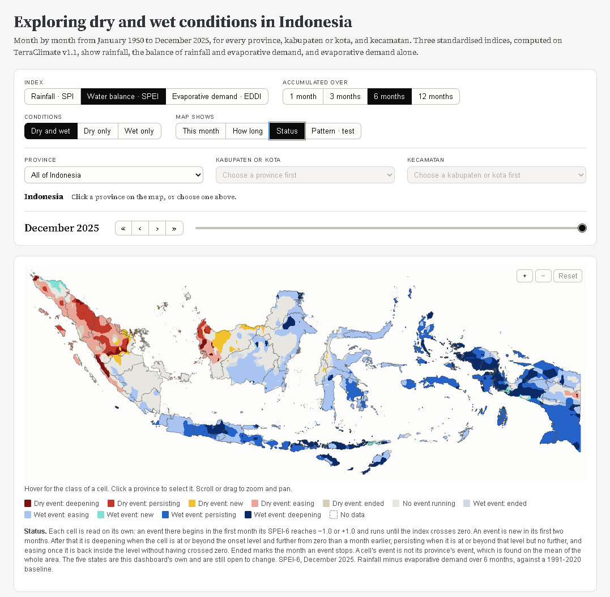

An interactive dashboard of dry and wet conditions across Indonesia, month by month from January 1950 to December 2025, for every province, kabupaten or kota, and kecamatan. It reads **rainfall (SPI)**, **water balance (SPEI)** and **evaporative demand (EDDI)** side by side, and turns the map into a written account of the place you click.

::: {.project-meta}
::: {.meta-item}
::: {.meta-label}
Year
:::
::: {.meta-value}
2026
:::
:::

::: {.meta-item}
::: {.meta-label}
Type
:::
::: {.meta-value}
Personal weekend project
:::
:::

::: {.meta-item}
::: {.meta-label}
Coverage
:::
::: {.meta-value}
Indonesia, January 1950 to December 2025 (912 months), on the 1/24 degree TerraClimate grid
:::
:::

::: {.meta-item}
::: {.meta-label}
Data
:::
::: {.meta-value}
TerraClimate v1.1; boundaries from Badan Informasi Geospasial; ENSO indices from the NOAA Climate Prediction Center
:::
:::

::: {.meta-item}
::: {.meta-label}
Tools
:::
::: {.meta-value}
Python, xarray, Observable Framework
:::
:::

::: {.meta-item}
::: {.meta-label}
Built on
:::
::: {.meta-value}
[precip-index](2025-precip-index.qmd) for SPI and SPEI, [nino](https://github.com/bennyistanto/nino) for EDDI and the ENSO tables
:::
:::

::: {.meta-item}
::: {.meta-label}
License
:::
::: {.meta-value}
Mozilla Public License 2.0
:::
:::

::: {.meta-item}
::: {.meta-label}
Links
:::
::: {.meta-value}
[Dashboard](https://bennyistanto.github.io/drywet-explorer/) · [GitHub](https://github.com/bennyistanto/drywet-explorer) · [Method](https://github.com/bennyistanto/drywet-explorer/blob/main/docs/method.md)
:::
:::
:::

## What it can tell you

For any province, kabupaten or kota, or kecamatan, and for Indonesia as a whole:

- **How much of the area is dry or wet**, and how that month ranks against the same month in earlier years.
- **How long the current event has lasted**, and whether it is deepening, holding or easing.
- **How long droughts lasted here in the past, and which were the worst**: every event since 1950 with its duration, magnitude and peak.
- **Where inside the area it is worst**, with the units inside ranked for the month.
- **What El Niño and La Niña years have looked like here**, month by month and episode by episode.
- **Whether the cause is lack of rain, high evaporative demand, or both.**
- **Whether conditions have been trending drier or wetter** over the decades.

## Five ways to colour the map

| Map shows | Each cell is coloured by |
|---|---|
| This month | the class of the index, from extremely dry to extremely wet |
| How long | the months the dry or wet event running in that cell has lasted |
| Status | what that event is doing: new, deepening, persisting, easing, ended |
| Pattern | the space-time pattern of the last 12 months, from an emerging hot spot analysis |
| Driver | which of the three indices is beyond the threshold: rain deficit, high demand, or both |

Every section under the map follows that choice.

## Method in brief

- **Indices.** SPI, SPEI and EDDI at 1, 3, 6 and 12 months, all standardised against 1991 to 2020 and all on one grid.
- **Units.** A unit's cells are every land cell its polygon touches, each counted at its full area.
- **Classes.** The seven classes of the WMO SPI User Guide; EDDI uses its own percentile categories.
- **Events.** After the same guide: an event starts when the index reaches 1.0 on the dry or wet side and ends when it returns to zero. Each has a duration, magnitude, intensity and peak.
- **The browser never reads an index cube.** The pipeline reduces the cubes to small per-decade and per-unit files.

The [method document](https://github.com/bennyistanto/drywet-explorer/blob/main/docs/method.md) gives every definition, the equations and the inputs needed to repeat it with other data.

## What the record says about itself

- **An event is not the same as being dry this month.** Under the event rule, 28% to 35% of all months fall inside a dry event, depending on the scale.
- **An event of a large area is an event of its average.** The national mean SPI-3 stayed on the wet side for the 19 months from June 2024 to December 2025, yet only 8% of the area was in a wet event of its own throughout.
- **No index gives early warning of another here.** Rainfall and demand cross the threshold in the same month more often than either leads.
- **Months before 1970**, and before 1984 in parts of Sumatra and Kalimantan, are less reliable and are drawn washed out.

It describes the record up to December 2025. It is not a forecast.

::: {.back-link}
[← Back to Projects](../projects.qmd)
:::
