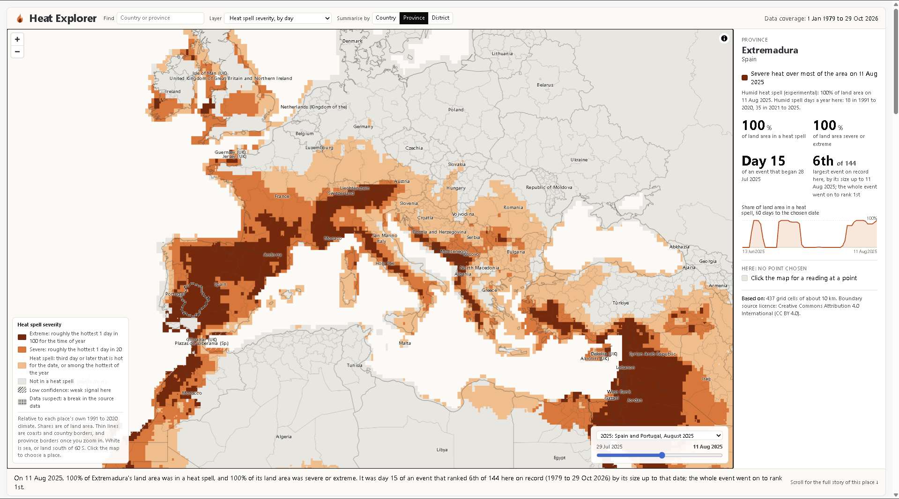

An interactive dashboard of heat spells over the world's land, day by day from 1 January 1979 to 29 October 2026, for every country, province and district. It is built around **one definition of a heat spell, frozen and tested on events it had never seen**, and it marks on the map **where the source data cannot be trusted**.

::: {.project-meta}
::: {.meta-item}
::: {.meta-label}
Year
:::
::: {.meta-value}
2026
:::
:::

::: {.meta-item}
::: {.meta-label}
Type
:::
::: {.meta-value}
Personal weekend project
:::
:::

::: {.meta-item}
::: {.meta-label}
Coverage
:::
::: {.meta-value}
Global land, 1 January 1979 to 29 October 2026, on the 0.1 degree AgERA5 grid; countries, provinces and districts
:::
:::

::: {.meta-item}
::: {.meta-label}
Data
:::
::: {.meta-value}
[AgERA5](https://doi.org/10.24381/cds.6c68c9bb), Copernicus Climate Change Service; boundaries from FieldMaps and OpenStreetMap contributors
:::
:::

::: {.meta-item}
::: {.meta-label}
Tools
:::
::: {.meta-value}
Python, Observable Framework, MapLibre GL
:::
:::

::: {.meta-item}
::: {.meta-label}
License
:::
::: {.meta-value}
Mozilla Public License 2.0
:::
:::

::: {.meta-item}
::: {.meta-label}
Links
:::
::: {.meta-value}
[Dashboard](https://bennyistanto.github.io/heat-explorer) · [GitHub](https://github.com/bennyistanto/heat-explorer) · [Detector definition](https://github.com/bennyistanto/heat-explorer/blob/main/docs/detector-v1-frozen.md) · [AgERA5 against stations](https://github.com/bennyistanto/heat-explorer/blob/main/docs/agera5-vs-stations.md)
:::
:::
:::

## What it can tell you

For any country, province or district, and for any point on the map:

- **How much of the area is in a heat spell on a given date**, and how much of it is severe or extreme.
- **How long the current event has lasted**, and how it ranks against every event there since 1979.
- **Whether the heat is by day, by night, or both.**
- **Where inside the area the heat sat**, week by week.
- **What past heat waves looked like**: 61 documented events since 1995 can be opened from the Period menu.
- **Whether heat spell days are becoming more common** over the decades.
- **How far to trust the numbers** in that place.

## Map layers

| Layer | Each grid cell is coloured by |
|---|---|
| Heat spell severity, by day | the class that day: heat spell, severe or extreme |
| Severe days, or heat spell days, in a year | the count for the chosen year |
| Severe days, or heat spell days, in a month | the count for the chosen month |
| Season status, last 12 weeks | whether heat there is new, back again, continuing or over |
| Trend in heat spell days | the change per decade, where it passes a significance test |
| Humid heat spell (experimental) | whether heat and humidity together were unusual |

## What "heat spell" means here

Three or more days in a row when the three-day average of daily mean temperature is in the top tenth for that date and above the place's median for the year, or in the top twentieth of the whole year. A spell day is **severe** when it is among roughly the hottest 1 day in 20 for that time of year in 1991 to 2020, and **extreme** when among the hottest 1 in 100.

This is the project's own definition, frozen as detector version 1.0: it does not change without a new version number and a new test on events not used before.

## How it was checked

- **Held-out events.** A test with its events and pass mark written before the run: the admin unit read severe on a documented day in 9 of 10 cases, and the point readout in 8 of 10. Two earlier suites did not pass and are recorded as such.
- **Against weather stations.** AgERA5 follows observed hot days well in the mid-latitudes and poorly near the equator, where it catches fewer than half of the hot days a station records.
- **A confidence class for every cell.** That skill follows the spread of AgERA5's own daily anomalies, so it can be mapped without stations. The low class covers 17 percent of land and is hatched on the map.
- **Two implementations, one answer.** The fast production code was checked identical to the one-cell reference code on 35.5 million cell-days.

## Read this before trusting a number

- Everything is relative to each place's own 1991 to 2020 climate. It is not a measure of heat stress on people.
- Shares are of land area, not of people. A small district rests on few grid cells.
- 1,301 grid cells have a known break in the source data. They are marked, and kept in every number.
- The humid heat layer is experimental.
- It is not a forecast and not a warning service.

::: {.back-link}
[← Back to Projects](../projects.qmd)
:::
