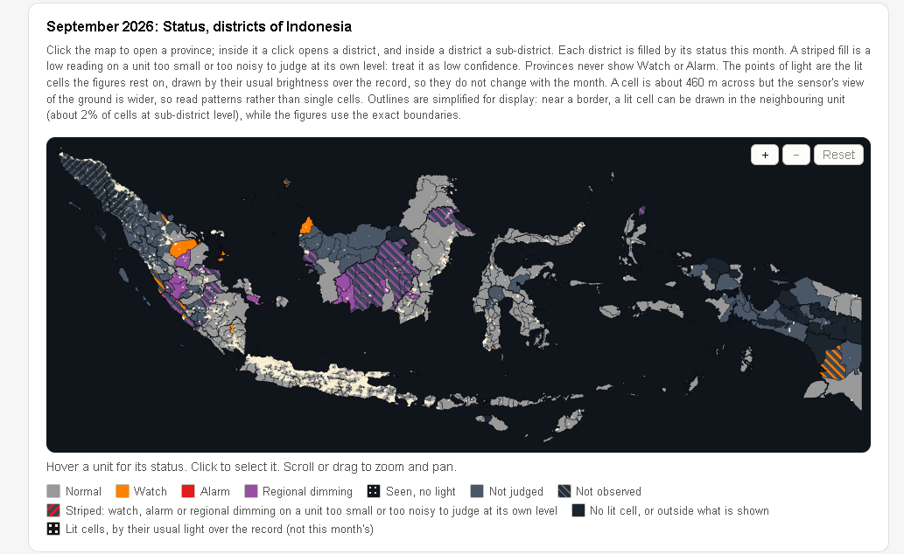
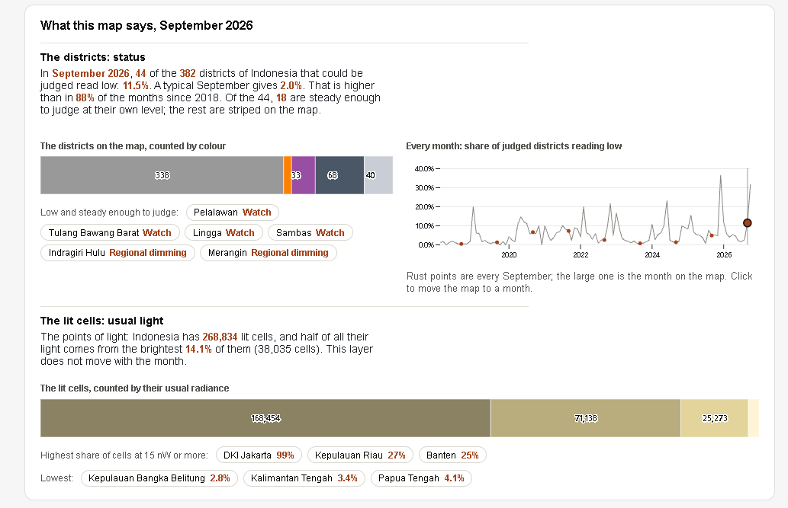
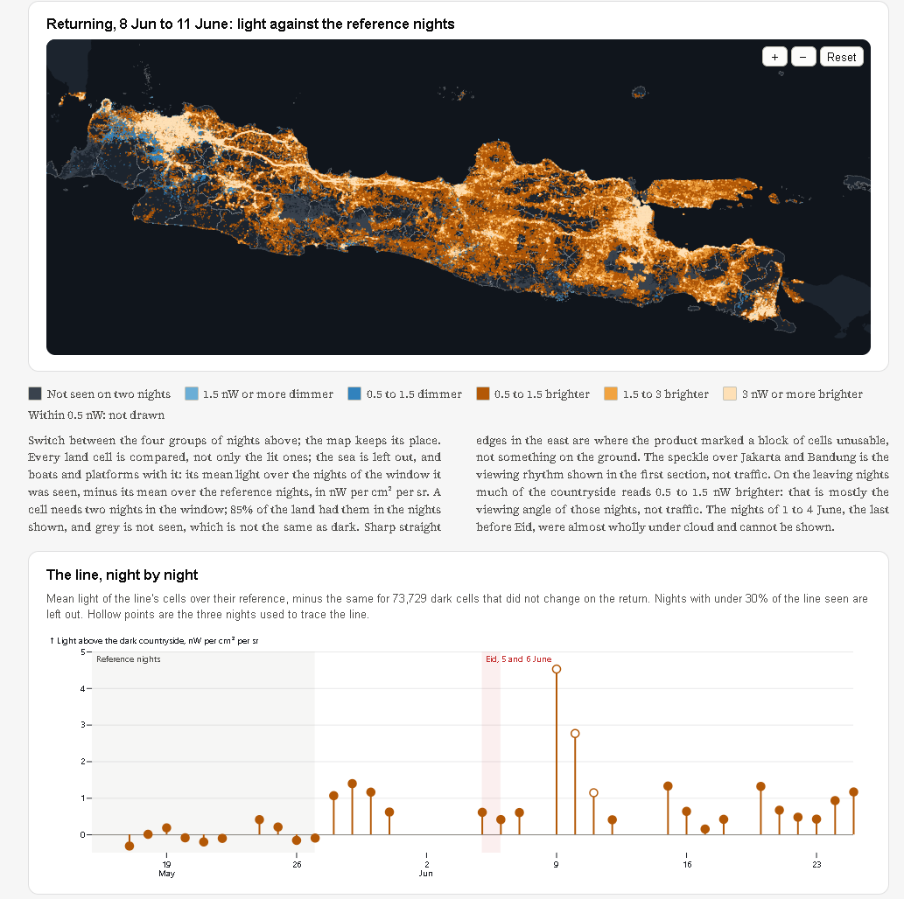

An interactive dashboard of night-time lights over Indonesia, month by month from January 2012 to October 2026, with four events followed night by night. For any province, district or sub-district it says whether the place is **dimmer than its own past says it should be**, whether that dimming is **its own or shared with the area around it**, and **how far the reading can be trusted**.

::: {.project-meta}
::: {.meta-item}
::: {.meta-label}
Year
:::
::: {.meta-value}
2026
:::
:::

::: {.meta-item}
::: {.meta-label}
Type
:::
::: {.meta-value}
Personal weekend project
:::
:::

::: {.meta-item}
::: {.meta-label}
Coverage
:::
::: {.meta-value}
Indonesia, January 2012 to October 2026, on the 15 arc-second Black Marble grid; 38 provinces, 490 districts and 4,479 sub-districts with at least one lit cell
:::
:::

::: {.meta-item}
::: {.meta-label}
Data
:::
::: {.meta-value}
NASA Black Marble Collection 2 (VNP46A3 monthly, VNP46A2 and VNP46A1 daily); boundaries from Badan Informasi Geospasial
:::
:::

::: {.meta-item}
::: {.meta-label}
Tools
:::
::: {.meta-value}
Python, Observable Framework, D3, Observable Plot
:::
:::

::: {.meta-item}
::: {.meta-label}
License
:::
::: {.meta-value}
Mozilla Public License 2.0
:::
:::

::: {.meta-item}
::: {.meta-label}
Links
:::
::: {.meta-value}
[Dashboard](https://bennyistanto.github.io/nightlights-explorer) · [GitHub](https://github.com/bennyistanto/nightlights-explorer) · [Method](https://github.com/bennyistanto/nightlights-explorer/blob/main/docs/method.md)
:::
:::
:::

## What it can tell you

- **Is this place dimmer this month than its own past says it should be?** Each unit is compared with an expected value fitted to its own earlier months only.
- **Is the dimming its own, or the area's?** The same anomaly is computed for the rest of the parent unit, so haze or a wet season over a whole province reads as regional dimming and not as an alarm.
- **Can the reading be trusted?** How much of the place was seen through the cloud, and whether it has enough steady light to be judged at all.
- **Has it lasted?** How many months a low reading has gone on, and how often that has happened before.
- **Where did light change?** Where new light appeared since 2012, where existing light brightened, where it faded, and where the faint lights are that are too dim to count.

It describes the record. It is not a forecast and not a warning service, and it makes no claim about electricity, outages or the economy.

## The page under the map

Units can be coloured by nine things and the lit cells, each about 460 m across, by six. A click opens a province, then a district, then a sub-district, and the map zooms to each. Under the map a card says in words what the chosen layers show that month, and a second card follows the selected unit.

## Method in brief

- **Three states, never two.** A cell is observed and usable, observed and rejected, or not observed. Not observed is never dark: in a typical month about 40% of units are not observed, because of cloud.
- **Like for like.** A unit's light is taken over the usual light of the same cells that were seen that month, on a log scale.
- **Expected from its own past.** A robust regression on earlier months only, with one slope for growth and one level per calendar month.
- **Thresholds from the record.** Watch and alarm are the 5% and 1% quantiles of standardised anomalies pooled over every unit of the level, from earlier years only.
- **Honest about sensitivity.** The median one-month drop a unit would reliably catch is 31% for provinces, 34% for districts and 38% for sub-districts.

The [method document](https://github.com/bennyistanto/nightlights-explorer/blob/main/docs/method.md) gives the data, the equations, what was tested and what was tried and dropped.

## Four case studies, night by night

A month hides an event that lasts days: in August 2018, the month of the Lombok earthquakes, every Lombok district read normal. Four events are therefore followed on the daily product. The main finding is about the instrument: the satellite sees a place from a different angle each night, on a 16-night cycle, and the light changes with that angle by tens of percent. Nights are compared only with nights seen alike.

| Case | What it found |
|---|---|
| Lombok 2018 | Most of the dimming after the earthquakes was the viewing angle. Two nights stand out, one of them unexplained |
| Palu 2018 | Under half the light on the night of the earthquake, and weeks to come back |
| Nyepi 2026 | On the Balinese day of silence the island gave under a tenth of its light |
| Mudik 2019 | The exodus before Eid does not show in the cities. On the roads one night stands out: the Sunday of the return |

## The long view

The older DMSP satellites (1992 to 2013) are shown beside VIIRS on one time axis, per province and district. The two records are not joined: a conversion between them comes within 3% for the country and misses provinces by a fifth to a quarter.

## Read this before trusting a number

- Everything is relative to each place's own past. Nothing has been checked against records on the ground.
- Which cells count as lit is decided from the whole record, so the map uses knowledge a monitor would not have had at the time.
- Each case study rests on one event.

::: {.back-link}
[← Back to Projects](../projects.qmd)
:::
