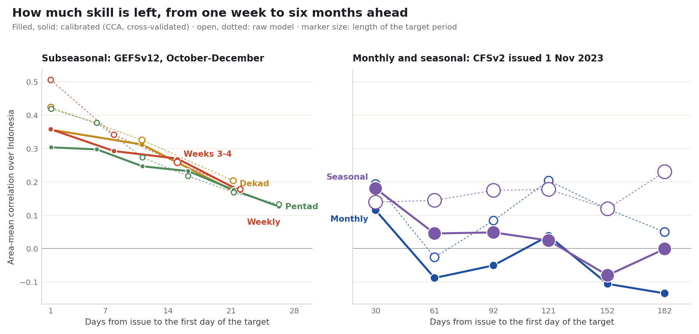
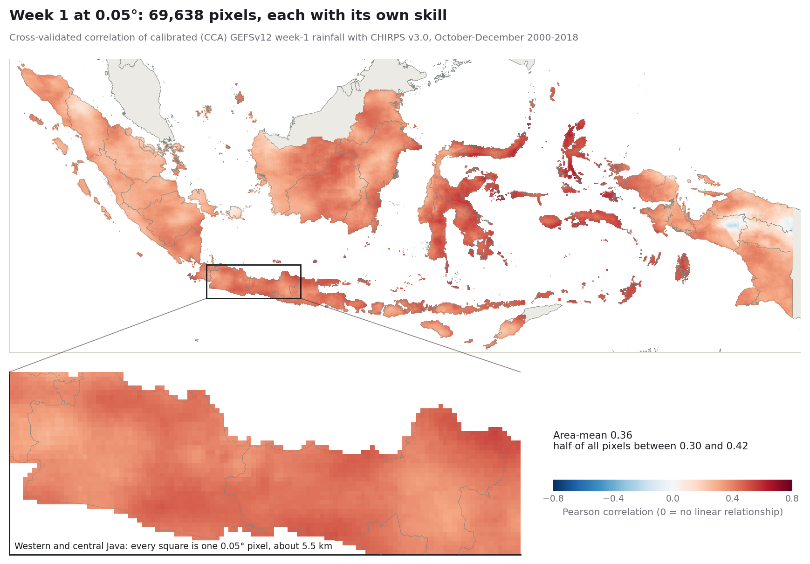
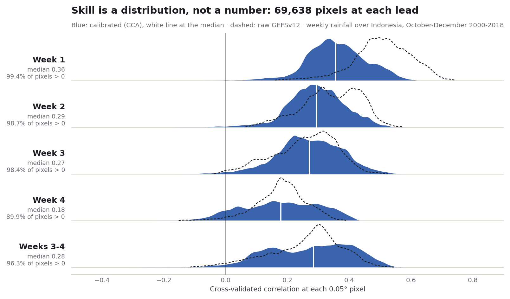

A practical, evidence-first tutorial on calibrating seasonal and subseasonal rainfall forecasts with [PyCPT](https://iri-pycpt.github.io/) and CPT, worked through with real data over Indonesia. The chapters and case studies are **executed notebooks, or stories built from them**, and the numbers in the text come from the executed outputs, **including the leads and seasons where calibration does not help**.

::: {.project-meta}
::: {.meta-item}
::: {.meta-label}
Year
:::
::: {.meta-value}
2026
:::
:::

::: {.meta-item}
::: {.meta-label}
Type
:::
::: {.meta-value}
Personal weekend project. Not an official PyCPT tutorial, and not affiliated with or endorsed by IRI or the developers of PyCPT and CPT
:::
:::

::: {.meta-item}
::: {.meta-label}
Coverage
:::
::: {.meta-value}
Indonesia, forecasts centred on 2023, verified on the native 0.05 degree CHIRPS v3.0 grid
:::
:::

::: {.meta-item}
::: {.meta-label}
Models
:::
::: {.meta-value}
CFSv2 and GEFSv12 for the single-model cases; seven seasonal models and five SubX models for the ensembles
:::
:::

::: {.meta-item}
::: {.meta-label}
Tools
:::
::: {.meta-value}
PyCPT 2.10, CPT, Python, xarray, Quarto
:::
:::

::: {.meta-item}
::: {.meta-label}
License
:::
::: {.meta-value}
Mozilla Public License 2.0 for the code; data and boundaries keep the terms of their sources
:::
:::

::: {.meta-item}
::: {.meta-label}
Links
:::
::: {.meta-value}
[Tutorial](https://bennyistanto.github.io/pycpt-tutorial) · [GitHub](https://github.com/bennyistanto/pycpt-tutorial) · [Methods and limitations](https://bennyistanto.github.io/pycpt-tutorial/guides/methods.html)
:::
:::
:::

## What is inside

**Learn PyCPT.** Seven chapters on the PyCPT 2.10 workflow, with one forecast question throughout: CFSv2, 1 September 2023 start, October to December 2023 rainfall over Indonesia, 1991 to 2020 training.

1. Your first PyCPT case
2. Getting the data
3. Bring your own observations
4. Evaluate a model
5. Reading probabilistic forecasts
6. Combining models
7. Adapt it to your region

**Case studies, seasonal.** Twelve seasons over Indonesia (CCA, PCR, the raw model and climatology, nationally and for 38 provinces), a fit-and-diagnose walkthrough, and seasonal and monthly lead-time cases as a single model and as a multi-model ensemble.

**Case studies, subseasonal.** Dekad, weekly and pentad forecasts, each as a single model (GEFSv12) and as a five-model ensemble.

## How far ahead?

For the subseasonal cases the calibrated area-mean correlation falls from 0.30 to 0.36 for targets starting the day after issue to 0.13 to 0.17 three to four weeks ahead. For the CFSv2 run issued 1 November 2023, monthly and seasonal correlations are at most 0.18.

## Every pixel has its own skill

The lead-time cases keep the native 0.05 degree grid, so skill is reported per pixel and not only as an area mean.

## Reproducible by design

- **Stories and notebooks in pairs.** Each case has a readable story and the executed notebook behind it.
- **Outputs kept.** Scores, comparisons and maps are saved as NetCDF, CSV and JSON, with downloadable kits per case study.
- **Frozen research benchmarks.** Seven experiments, each with its outputs, a README and manifests listing every file's SHA-256 hash.
- **Three levels of running it.** Re-run the saved-results analysis, fit models in the tested PyCPT 2.10.4 environment, or download new data.

## What it does not claim

All cases are retrospective learning examples. Their results do not establish operational forecast skill or probability reliability, and no significance tests are claimed.

::: {.back-link}
[← Back to Projects](../projects.qmd)
:::
