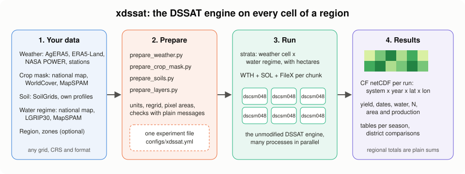

**xdssat** runs gridded crop simulations with the [DSSAT-CSM](https://github.com/DSSAT/dssat-csm-os) engine, driven from Python and xarray. It does not reimplement DSSAT: it writes the engine's own input files for every grid cell and season, runs the **unmodified `dscsm048` engine in parallel**, and collects the results into **one CF netCDF file**.

::: {.project-meta}
::: {.meta-item}
::: {.meta-label}
Year
:::
::: {.meta-value}
2026
:::
:::

::: {.meta-item}
::: {.meta-label}
Type
:::
::: {.meta-value}
Personal weekend project. Independent and experimental: not developed or endorsed by the DSSAT Foundation
:::
:::

::: {.meta-item}
::: {.meta-label}
Case studies
:::
::: {.meta-value}
Rice in Java (main); maize after rice in East Java, millet in Niger, maize in Kenya, rice in the Mekong Delta and in northern Luzon
:::
:::

::: {.meta-item}
::: {.meta-label}
Inputs
:::
::: {.meta-value}
Your own data, or global datasets such as AgERA5, ERA5-Land, NASA POWER, SoilGrids, WorldCover and LGRIP30
:::
:::

::: {.meta-item}
::: {.meta-label}
Tools
:::
::: {.meta-value}
Python, xarray, DSSAT-CSM, Quarto
:::
:::

::: {.meta-item}
::: {.meta-label}
Built on
:::
::: {.meta-value}
[DSSAT](https://dssat.net/), whose engine (BSD-3, DSSAT Foundation) is built from its own repository and is not included
:::
:::

::: {.meta-item}
::: {.meta-label}
License
:::
::: {.meta-value}
Mozilla Public License 2.0
:::
:::

::: {.meta-item}
::: {.meta-label}
Links
:::
::: {.meta-value}
[Documentation](https://bennyistanto.github.io/xdssat/) · [GitHub](https://github.com/bennyistanto/xdssat) · [Scientific method](https://bennyistanto.github.io/xdssat/java/science.html)
:::
:::
:::

## What it does

DSSAT was designed around field experiments: one plot, one weather station, one soil profile. xdssat puts Python in the place of the DSSAT shell so the same model can be run over a region.

| What the DSSAT shell does | What xdssat does instead |
|---|---|
| XBuild writes an experiment file | writes one with a treatment per field, grid cell or scenario |
| WeatherMan imports and checks weather | reads and writes weather files, with pandas for the checks |
| SBuild builds soil profiles | builds them from soil maps as well as from soil sheets |
| The cultivar file is edited by hand | writes per-run copies with changed coefficients |
| One run at a time from the shell | runs in parallel chunks |
| Results in text output files | tables, and CF netCDF maps for gridded runs |

Every setting of a run (machine paths, area, cultivars, nitrogen rates, water regimes, planting calendar, scenarios such as CO2 or warming, years) lives in one file.

## A real case: rice in Java

The current run simulated 84,870 rice seasons over 1,187 weather cells of 0.1 degree for the 1991 to 2020 season years, in 15.5 minutes on 32 engine processes, with none rejected by the engine. Results are added up the way the district statistics are, and compared with them.

## What fits, and what does not

- **The level fits.** Simulated over observed yield for Java, weighted by district rice area, is 1.00 after calibration.
- **The map partly fits.** The spatial correlation of simulated and observed district means is r = 0.32.
- **Year-to-year swings do not match.** After removing the trend, the median correlation over the years in a district is -0.13.
- **No trend.** Observed Java yield rises by about 3.1 ku/ha per decade; the simulated yield does not, because the cultivar and nitrogen rate are held fixed for 30 years.

## Also in the documentation

- **Five further case studies**, each asking a question of its own.
- **A six-module DSSAT training** with notebooks that run the real engine: phenology, growth, weather and soils, calibration, water and nitrogen, seasonal risk and crop rotations.
- **Five small example areas** with inputs already prepared from public data, ready to run.

## Please note

xdssat is experimental. Check its results against your own data before relying on them, and if you publish results made with it, cite DSSAT as the DSSAT Foundation asks.

::: {.back-link}
[← Back to Projects](../projects.qmd)
:::
